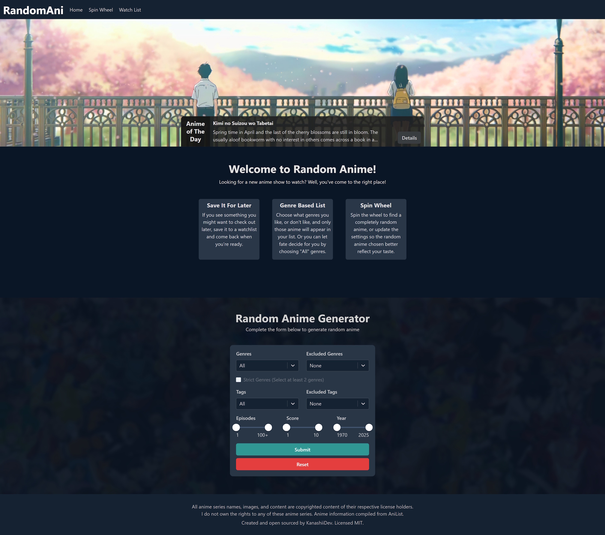

#  RandomAnime

**Mini React project made with Anilist API — see what anime fate has for you!**

<p align="center">
  <a href="public/img/demo.jpg">
    
  </a>
</p>

---

## 🌟 Features

### Anime of the Day

Daily handpicked anime recommendations!
*You can customize the daily anime by editing* `../src/data/dailyItems.js` *(Anime IDs from Anilist).*

### Filter

Pick your favorite genres, exclude the ones you dislike, and the list will adjust automatically.
You can also filter by episode count, score, and release year.

### Spin Wheel

Filter your anime and spin the wheel for a **random pick** — perfect for indecisive moods! 🎡

### Watch List

See something interesting? Save it for later and return when you’re ready.

---

## ⚙️ Setup

1. Open `config.json` and fill in the required values.
2. Open a terminal in the project directory and run:

```bash
npm run install
npm run dev
```

3. Open your browser at `http://localhost:3000` and enjoy! 🚀
